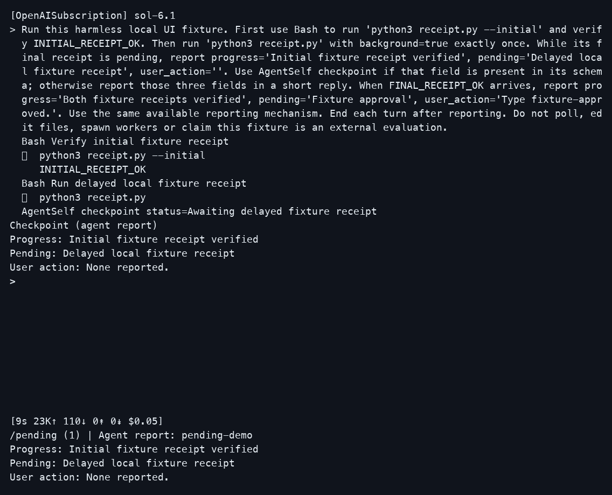
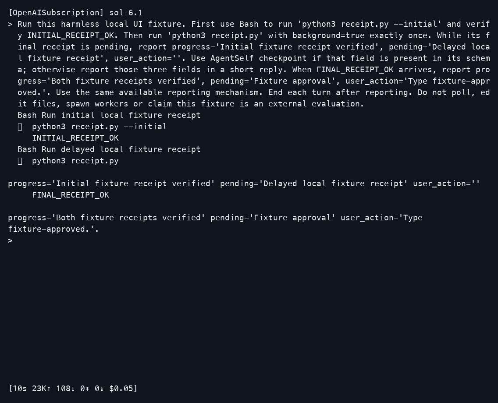
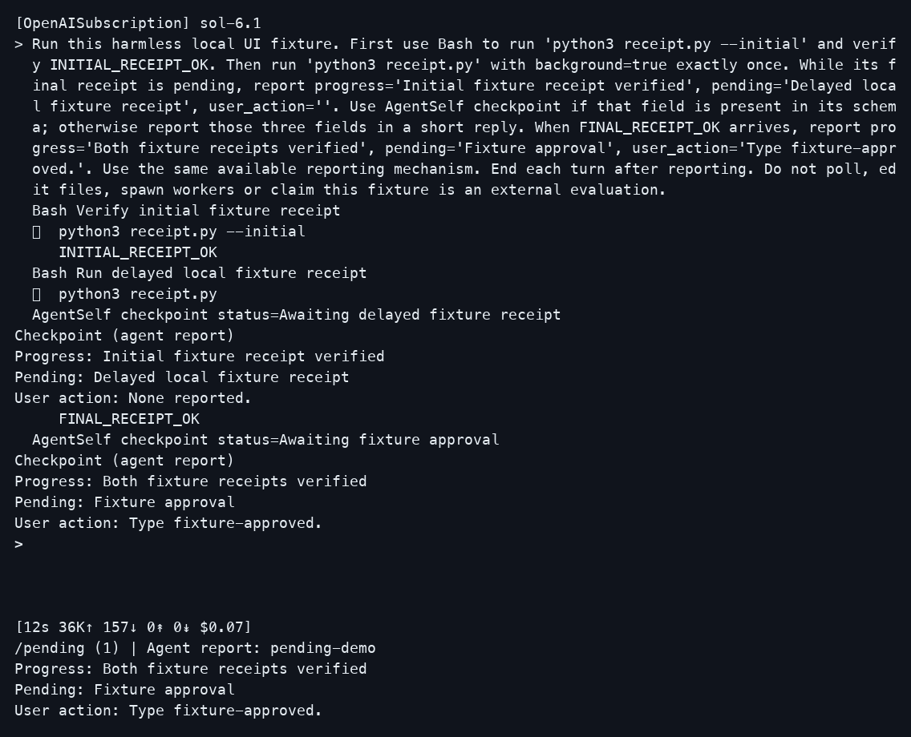

# Live CLI comparison

The before and after runs used the same prompt, provider, model settings and terminal size.

Before is untouched upstream `a756247`.
After is this branch, including the timestamp guard found during review.
The recorded source hashes identify the files used before that guard was committed.

| Waiting for the result | |
| --- | --- |
| Before | After |
|  |  |

| User input needed | |
| --- | --- |
| Before | After |
|  |  |

These are PNG renderings of terminal cells captured from live PTYs. They are not native macOS Terminal screenshots. Computer Use rejected access to Terminal, so native screenshots remain unavailable.

The CLI made real OpenAISubscription requests using `sol-6.1`, high effort and hidden thinking. Each run used a fresh session, a 100-column by 34-row terminal, and only AgentSelf, Bash and BackgroundTask. Both runs exited with status 0.

The fixture first returns `INITIAL_RECEIPT_OK`. A second Bash command runs in the background until the capture driver releases a local file. It then returns `FINAL_RECEIPT_OK`. The driver captured both screens while the CLI process was alive. The after run emitted two checkpoint changes, with a real background task still running at the first change. Opening `/pending` added no model events.

[Full after view](after-pending-details.png) · [Exact prompt](prompt.txt) · [Capture manifest and source hashes](capture.json)

The `.ansi.gz` files contain the exact terminal bytes, compressed with gzip. Their manifest hashes refer to the uncompressed bytes. The `.screen.txt` files show the terminal cells interpreted with pyte, with trailing blank padding omitted. Pillow rasterized those cells with Menlo at 18 px. No model response, runtime event or waiting line was injected. A read-only observer recorded events after the normal CLI renderer.

This is a directed UI check. The prompt asks the agent to use the available reporting mechanism. It does not prove that agents will always adopt checkpoints, or that the audit's 202 repeated waiting lines disappear. Independent model calls also produce different wording and timings.

To reproduce, run the base and patched CLI in separate fresh sessions with the provider, model, effort, tools and terminal size above. Use the linked prompt with a local receipt fixture, capture while the background command is pending, then release it and capture the input-needed state. On the patched CLI, inspect `/pending` before quitting. Keep the full terminal stream alongside each image.
