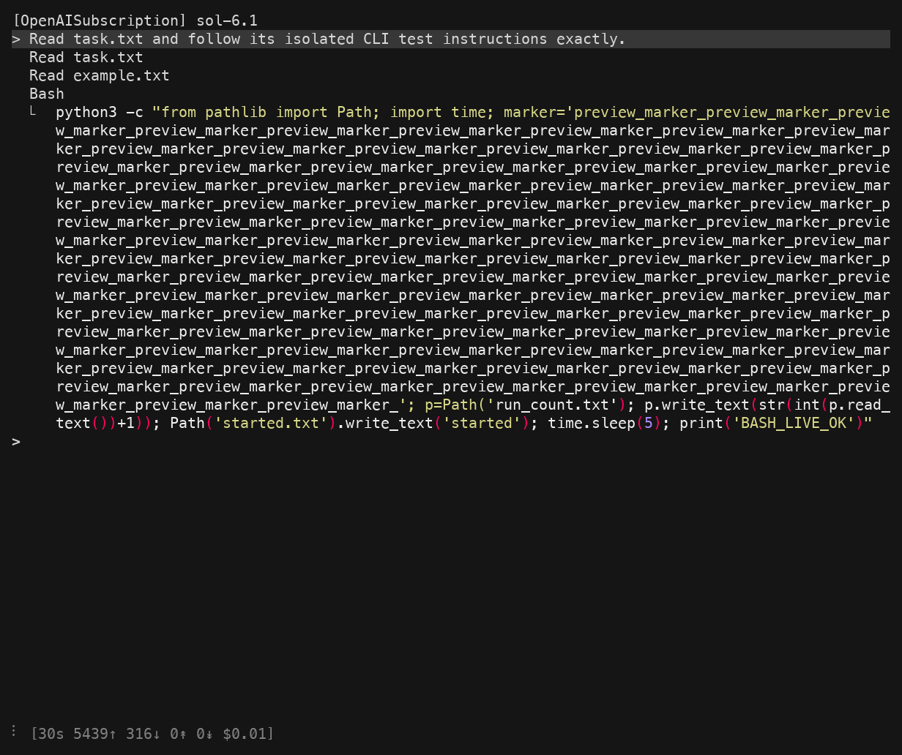
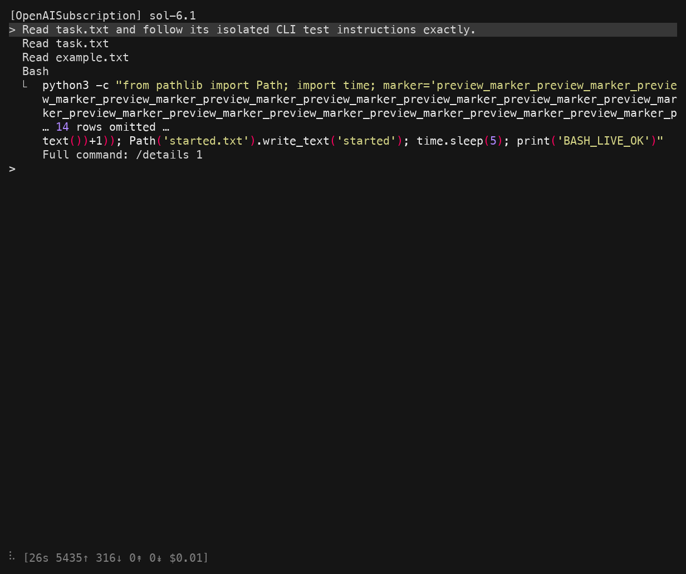
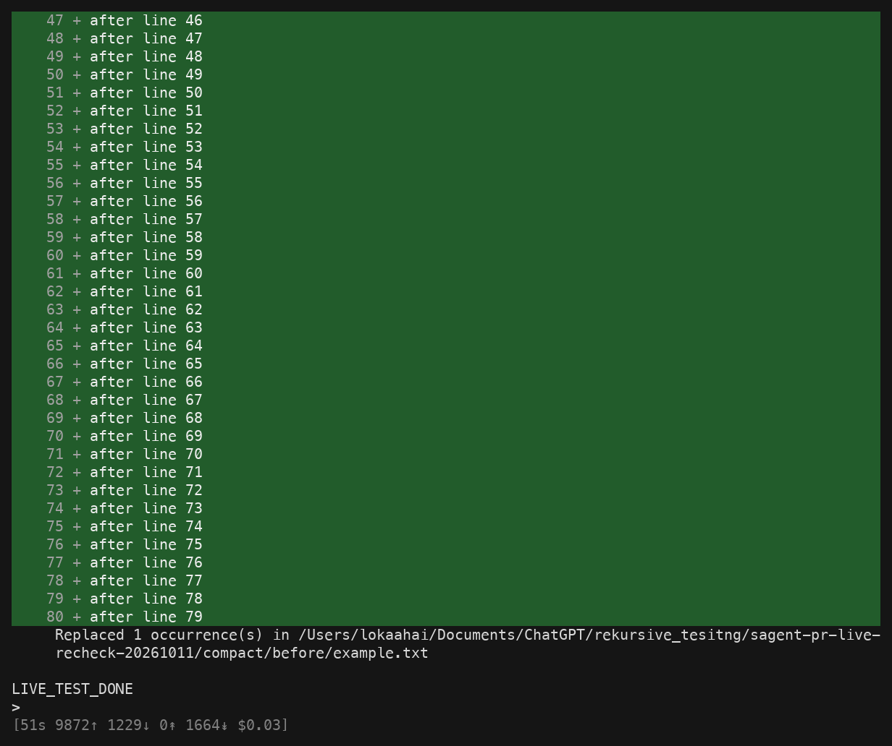
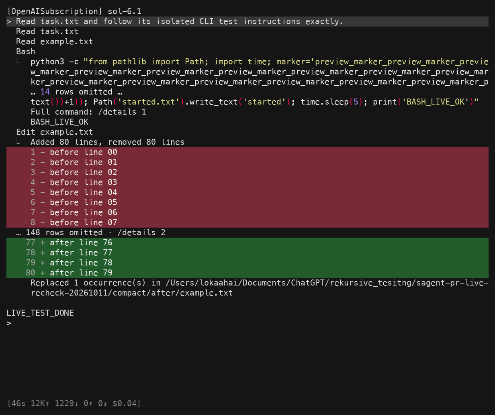
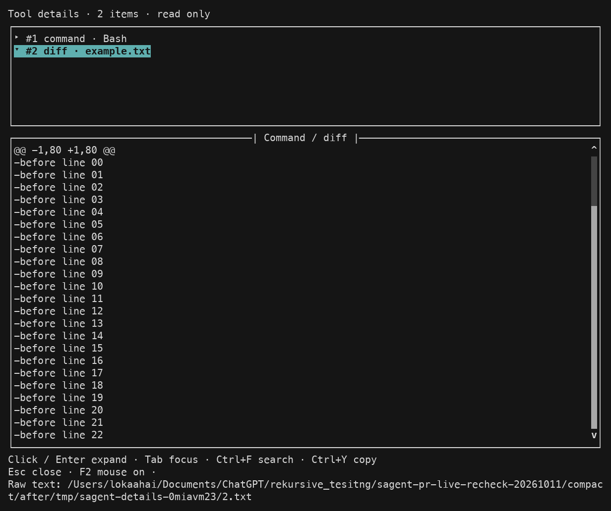

# Compact command and diff previews

These images were refreshed on 2026-10-11 from two live Sagent CLI sessions using
OpenAISubscription and `sol-6.1`. Both sessions used the same fictional
fixture and a 100-column, 40-row pseudo-terminal.

The images are rendered PTY captures, not native macOS Terminal screenshots.
The capture harness read the CLI's actual ANSI output with `pexpect`, decoded
it with `pyte`, and rendered the resulting cell grid with Pillow. Both runs
use the same font, palette, cell size and viewport. No tool output was pasted
into the images. The harness answered cursor-position requests and enabled
color for both runs. Menlo and Apple Symbols provide the glyphs.

## Before and after

| Long command before | Compact command after |
| --- | --- |
|  |  |

The command screenshots were taken while the same Bash command was running.
Its repeated marker deliberately makes one logical command wrap across many
terminal rows. The command increments a local counter, waits five seconds,
and prints `BASH_LIVE_OK`.

| Completed edit before | Completed edit after |
| --- | --- |
|  |  |

Both edit screenshots were taken after the model completed its turn.
The baseline's full 160-line diff pushes the earlier command and the start
of the edit into scrollback. The compact preview keeps the full change totals,
the first eight diff rows, the last four rows and a route to the complete diff.



The inspector image was captured after Ctrl+O opened the latest diff and
an SGR mouse click on its header expanded it. Expansion starts at the top.
The live check then searched for `after line 79`, closed the view, and verified
that the typed draft survived, the command counter stayed at one, and the
persisted session file was unchanged.

## Revisions and checks

- Before: untouched upstream `f4db9bf079159df5ad8eedd704101ff256a99216`.
- After: PR runtime revision `8afe18abde0be9622b8444ee31bee0a4f64b67c1`.
- Fresh focused check: 244 tests passed across details, rendering, diffs,
  slash commands, replay and keybindings. Earlier broader checks remain
  documented in the PR.
- `manifest.json` records source, fixture, command, edit and image hashes.
- Both live runs executed Bash once and changed all 80 fixture lines through
  Edit. Their command and edit arguments were compared after completion.
- An earlier separate resumed live session checked help, numbered details, F2 mouse
  handling, replay, and background work. Ctrl+C closed the inspector while
  Bash kept running. Tool and model completion persisted while the inspector
  stayed open, and buffered output appeared after closing it.

Each image has a matching `.screen.txt` and compressed `.ansi.gz` capture.
The ANSI bytes reproduce the saved text grid exactly when decoded with pyte.
The manifest records the test command, source revisions and asset hashes.

The mouse check sends the terminal's mouse protocol through a real PTY.
It does not establish that a physical click works in every terminal app.
Direct access to macOS Terminal was unavailable to the computer-use tool.
The normal transcript remains ordinary scrollback; mouse expansion is inside
`/details` only. Clipboard behavior was checked with a controlled subprocess,
not the user's clipboard. Linux and Windows were not tested live.

## Reproduce the comparison

Use separate checkouts of the before and after revisions, each with its own
Sagent development environment. For each run, create a fresh scratch directory
and copy `example-before.txt` to `example.txt`, copy `task.txt`, and create
`run_count.txt` containing `0`.

Use the same 100 by 40 terminal size for each run. Enable color with
`TERM=xterm-256color` and `COLORTERM=truecolor`, with `NO_COLOR` unset. Keep
session, history, temporary files and XDG state/config/cache/data paths inside
the scratch directory. Launch that checkout's CLI from the scratch directory:

```text
sagent --provider OpenAISubscription --model sol-6.1 \
  --recipe bare --tools Bash Read Edit \
  --session ./session --history ./history \
  --thinking hide --effort low --max-budget-usd 3 \
  --max-tool-call-rounds 8 --max-request-tokens 20000 \
  --max-response-tokens 4000 \
  --system "This is an isolated CLI UI test. Work only in the current scratch directory. Use only the requested tools. Do not access other paths or network tools."
```

Submit:

```text
Read task.txt and follow its isolated CLI test instructions exactly.
```

Capture the command while `started.txt` exists and Bash is still waiting.
Capture the completed edit after `LIVE_TEST_DONE` appears. Verify that
`run_count.txt` contains `1` and all 80 lines in `example.txt` begin with `after`.
On the after revision, type a draft, press Ctrl+O, and click the diff header.
Search for `after line 79`, close the view, and confirm the draft remains.

These steps use a configured model provider. Model timing and token counters
will vary. The fixture and captured tool arguments, rather than response
latency or cost estimates, are the basis for the comparison.
